<picture>
  <source media="(prefers-color-scheme: dark)" srcset="docs/assets/banner-dark.svg">
  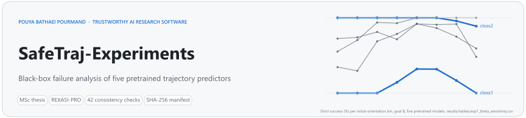
</picture>

<p align="center">
  <a href="https://github.com/pouyapd/SafeTraj-Experiments/actions/workflows/verify.yml"></a>
  
  <a href="LICENSE"></a>
  <a href="https://rexasi-pro.spindoxlabs.com/"></a>
</p>

<p align="center">
  <a href="#results">Results</a> ·
  <a href="#key-findings">Key findings</a> ·
  <a href="#methodology">Methodology</a> ·
  <a href="#verifying-the-published-results">Verify the results</a> ·
  <a href="#reproducibility">Reproducibility</a> ·
  <a href="#limitations">Limitations</a>
</p>

Research artifact accompanying the MSc thesis

> **Analysis of Neural Trajectory Prediction for Collision Avoidance in Smart Wheelchairs**
> Pouya Bathaei Pourmand, DIBRIS, University of Genoa, July 2026
> Supervisors: Prof. Luca Oneto, Prof. Maurizio Mongelli · Co-supervisor: Dr. Sara Narteni
> Carried out in collaboration with CNR within the EU Horizon Europe project [REXASI-PRO](https://rexasi-pro.spindoxlabs.com/)

> [!IMPORTANT]
> The five DNN-LNA models analysed in this work are **proprietary assets of the REXASI-PRO project and are not included** in this repository. The repository publishes the evaluation code, the derived results (tables, figures, extracted decision trees), checks that recompute the thesis numbers from those files, and a synthetic-data demonstration notebook. See [Reproducibility](#reproducibility) for what can and cannot be re-run.

## At a glance

<p align="center">
  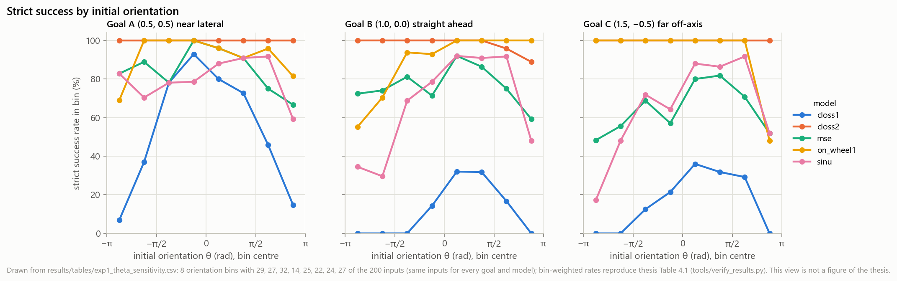
</p>
<p align="center"><sub>Strict success per initial-orientation bin for all five models and the three goals: a derived view of the published results (<code>results/tables/exp1_theta_sensitivity.csv</code>), not a thesis figure.</sub></p>

- Five pretrained trajectory predictors, each queried with the same 200 sampled commands for 3 goals (600 trajectories per model) and treated as black boxes.
- Strict success (final distance < 0.30 m) ranges from **25.3 % to 99.3 %** across models evaluated under identical conditions.
- Failures concentrate in identifiable command regions, chiefly initial orientations near ±π; depth-4 decision trees describe them as explicit rules (training accuracy 0.85–0.99).
- Every number in this README can be checked against the published result files: `python tools/verify_results.py` runs 42 checks, and all pass. A SHA-256 manifest guards the 40 published artifacts against any change.

## Why this matters

Smart wheelchairs increasingly rely on learning-based models that transform user commands into motion trajectories. Such neural trajectory predictors learn the command-to-trajectory mapping from demonstrations rather than from an explicit kinematic model, so their behaviour can vary strongly with the initial orientation, the velocity commands or the target position. In a safety-critical assistive setting an average performance figure is not enough: what matters is *under which conditions* a predictor fails.

The thesis evaluates five pretrained **DNN-LNA** (Deep Neural Network-based Local Navigation Approach) predictors developed within REXASI-PRO, strictly as **black boxes**: they are not retrained, and their architectures and weights are not modified. It asks two questions:

1. **Failure characterisation.** Which combinations of input commands make a pretrained predictor miss the intended goal, and what is the structure of these failure regions?
2. **Effect of the training objective.** How does the choice of training loss relate to the reliability of the different models across operational conditions and goals?

Both are answered from predicted trajectories alone, without access to model internals.

## Methodology

<p align="center">
  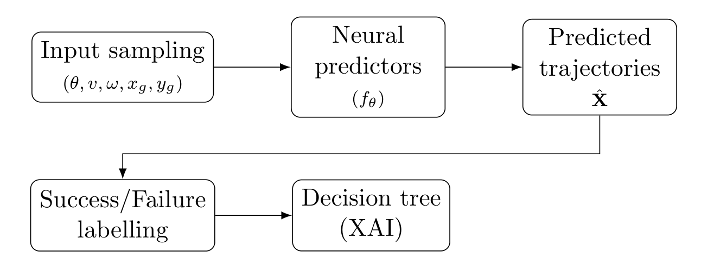 pretrained neural predictors -> predicted trajectories -> success/failure labelling -> decision tree (XAI)" width="620">
</p>
<p align="center"><sub>Overall pipeline (thesis Fig. 3.1). Inputs are sampled uniformly, fed to each pretrained model, and the resulting trajectories are labelled and analysed; a decision tree is fitted per model to extract interpretable failure rules.</sub></p>

1. **Sample the operational input space.** Commands (θ, v, ω) are drawn uniformly over their admissible ranges, which avoids grid aliasing and covers both typical and extreme configurations.
2. **Query the pretrained predictors** with every sampled input for each goal; the occupancy map is zero everywhere (obstacle-free workspace).
3. **Generate trajectories** of `T = 30` planar poses with linear and angular speeds, `Δt = 0.1 s` (3 s horizon).
4. **Compute the final goal distance** `d = sqrt((x̂_T − x_g)² + (ŷ_T − y_g)²)`.
5. **Assign strict and soft outcomes.** Strict: *Success* if `d < 0.30 m`. Soft: *Success* (`d < 0.30 m`), *Near-success* (`0.30 ≤ d < 0.50 m`), *Failure* (`d ≥ 0.50 m`).
6. **Build labelled data**: `(θ, v, ω, GoalX, GoalY) → Success/Failure`, `N × G = 600` observations per model.
7. **Fit decision-tree surrogates**: one `DecisionTreeClassifier` per model (`max_depth = 4`, `min_samples_leaf = 10`, Gini); training accuracy is reported as a consistency check between rules and observed outcomes.
8. **Compare models** through risk maps, per-goal success rates, average final distances, soft-outcome distributions and the extracted rules.

The empirical risk of an input bin `U_b` is the fraction of its samples that fail the strict threshold:

```
R(U_b) = (1 / N_b) · Σ_{j : (θ_j, ω_j) ∈ U_b}  1[ d_j ≥ 0.30 m ]
```

### Experimental design

| Condition | Value |
|---|---|
| Models | 5 pretrained DNN-LNA predictors (black-box) |
| Initial orientation θ | `[−π, π]` rad |
| Linear velocity v | `[−1.05, 2.88]` m/s (reverse and forward motion) |
| Angular velocity ω | `[−1.99, 1.99]` rad/s |
| Sampling | `N = 200` inputs, uniform random sampling (seed 42); the same inputs are reused for every goal |
| Occupancy map | zero everywhere (obstacle-free workspace) |
| Prediction horizon | `T = 30` steps, `Δt = 0.1 s` (3 s) |
| Goals (`G = 3`) | A, near lateral `(0.5, 0.5)` · B, straight ahead `(1.0, 0.0)` · C, far off-axis `(1.5, −0.5)` |
| Strict success | `d < 0.30 m` (grounded in the physical tolerances of the Rolland platform) |
| Soft outcomes | Success `d < 0.30` · Near-success `0.30 ≤ d < 0.50` · Failure `d ≥ 0.50` m |
| Decision tree | features `(θ, v, ω, GoalX, GoalY)`; `max_depth = 4`; `min_samples_leaf = 10`; Gini |

The thesis runs two analyses on the same sampled commands:

| | Experiment 1: input-space sensitivity | Experiment 2: goal-based difficulty |
|---|---|---|
| Question | *where* in the command space (θ, v, ω) does a model fail? | how does reliability change with the goal? |
| Goals | reference goal B `(1.0, 0.0)` | all three goals |
| Outputs | representative trajectories, risk maps, decision-tree rules | per-goal strict success (Table 4.1), average final distance (Table 4.2), soft-outcome distribution |

> [!NOTE]
> **File names follow the code, not the thesis chapters.** The pipeline's first stage (`run_exp1` in `src/evaluate.py`) already evaluates all three goals, and the result files that reproduce the thesis's Experiment 2 tables carry the `exp1_` prefix (`results/tables/exp1_*`). The files named `exp2_*` come from a separate run whose settings are not documented; they do **not** match the thesis tables, and no number in this README comes from them. [`docs/ARTIFACTS.md`](docs/ARTIFACTS.md) gives the status of every file.

## Models

Five pretrained DNN-LNA predictors are evaluated. They were developed and trained by the REXASI-PRO project partners (DFKI); the training procedure, dataset preparation and network design are documented in project deliverable D3.2 and are **not** part of this work.

| Model | Role in this study |
|---|---|
| `DNN_LNA_closs1` | Lowest strict success rate in the evaluation (25.3 %) |
| `DNN_LNA_closs2` | Highest strict success rate in the evaluation (99.3 %) |
| `DNN_LNA_mse` | Intermediate (74.7 %); characterised in the thesis as trained with a mean-squared-error criterion on trajectory poses |
| `DNN_LNA_on_wheel1` | Intermediate (90.7 %) |
| `DNN_LNA_sinu` | Intermediate (69.2 %) |

The models differ in loss functions, number of layers and input parametrisation, but share a common interface:

| | Content | Shape (batch of N) |
|---|---|---|
| Input | command vector `(θ, v, ω)` | `(N, 3)` |
| Input | goal vector `(x_g, y_g, 0, 0, 0)` | `(N, 5)` |
| Input | occupancy map (all zeros in this study) | `(N, 300, 300, 1)` |
| Output | trajectory `(x̂_t, ŷ_t, θ̂_t, v̂_t, ω̂_t)` for `t = 1 … 30` | `(N, 5, 30)` |

Trajectories are expressed in a robot-centric frame attached to the initial pose (start at the origin, initial heading along the x-axis).

## Results

All values below are taken from the thesis (Chapter 4) and are recomputed from the result files by `tools/verify_results.py`.

### Strict success rate per model and goal

Experiment 2, thesis Table 4.1 (image: [`results/figures/table_success_rate.png`](results/figures/table_success_rate.png)). `d < 0.30 m`, `N = 200` per cell; *Overall* is the mean across goals.

| Model | Goal A (0.5, 0.5) | Goal B (1.0, 0.0) | Goal C (1.5, −0.5) | **Overall** | Rank |
|---|:---:|:---:|:---:|:---:|:---:|
| `DNN_LNA_closs1` | 50.5 % | 10.5 % | 15.0 % | **25.3 %** | 5 |
| `DNN_LNA_closs2` | 100.0 % | 98.0 % | 100.0 % | **99.3 %** | 1 |
| `DNN_LNA_mse` | 83.5 % | 76.5 % | 64.0 % | **74.7 %** | 3 |
| `DNN_LNA_on_wheel1` | 91.0 % | 88.0 % | 93.0 % | **90.7 %** | 2 |
| `DNN_LNA_sinu` | 79.5 % | 64.5 % | 63.5 % | **69.2 %** | 4 |

<p align="center">
  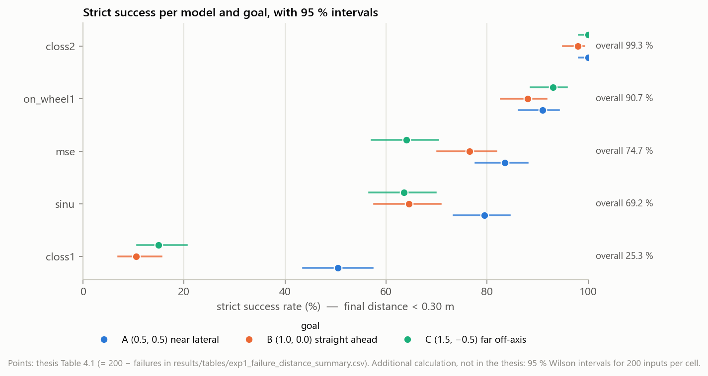
</p>
<p align="center"><sub>Table 4.1 with 95 % Wilson intervals for 200 inputs per cell (an additional calculation, not in the thesis; <code>python tools/derived_figures.py</code>). At every goal the point estimates rank closs2 > on_wheel1 > mse > sinu > closs1. The intervals of mse and sinu overlap at all three goals, and those of mse and on_wheel1 at goal A; the 200 inputs do not separate these pairs. All other pairs have non-overlapping intervals.</sub></p>

### Average final distance to goal (m)

Experiment 2, thesis Table 4.2 (image: [`results/figures/table_avg_distance.png`](results/figures/table_avg_distance.png)). Mean over all 200 trajectories per cell; lower is better.

| Model | Goal A | Goal B | Goal C | **Overall avg** |
|---|:---:|:---:|:---:|:---:|
| `DNN_LNA_closs1` | 0.305 | 0.603 | 0.538 | **0.482** |
| `DNN_LNA_closs2` | 0.123 | 0.137 | 0.129 | **0.130** |
| `DNN_LNA_mse` | 0.200 | 0.228 | 0.283 | **0.237** |
| `DNN_LNA_on_wheel1` | 0.188 | 0.190 | 0.150 | **0.176** |
| `DNN_LNA_sinu` | 0.216 | 0.261 | 0.255 | **0.244** |

The failed trajectories also differ in kind: the four failures of `closs2` stay within 0.36 m of the goal (near-misses), while failures of `closs1` end up to almost 1 m away.

<p align="center">
  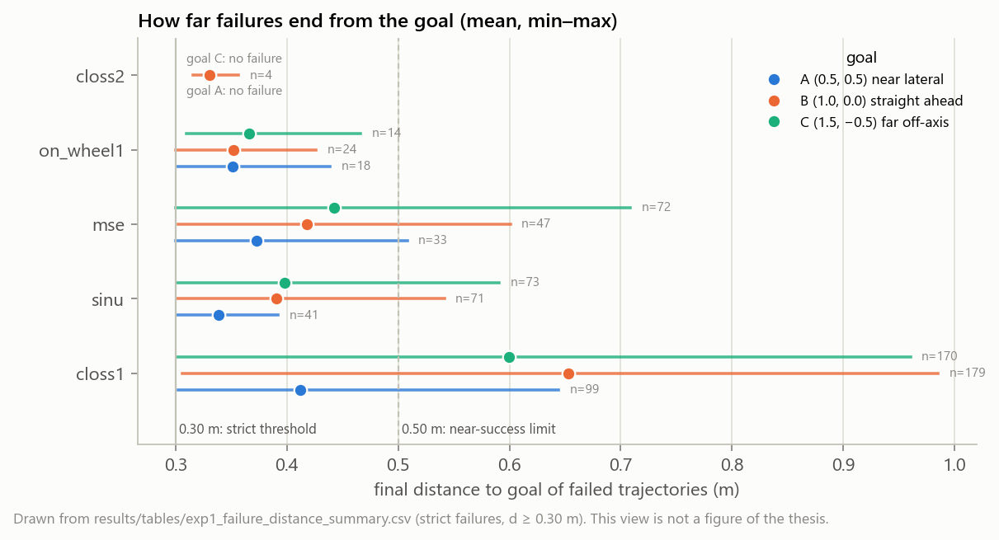
</p>
<p align="center"><sub>Final distance of the failed trajectories (mean, min–max) per model and goal, from <code>results/tables/exp1_failure_distance_summary.csv</code> (derived view, not a thesis figure).</sub></p>

### Experiment 1: where failures occur

<p align="center">
  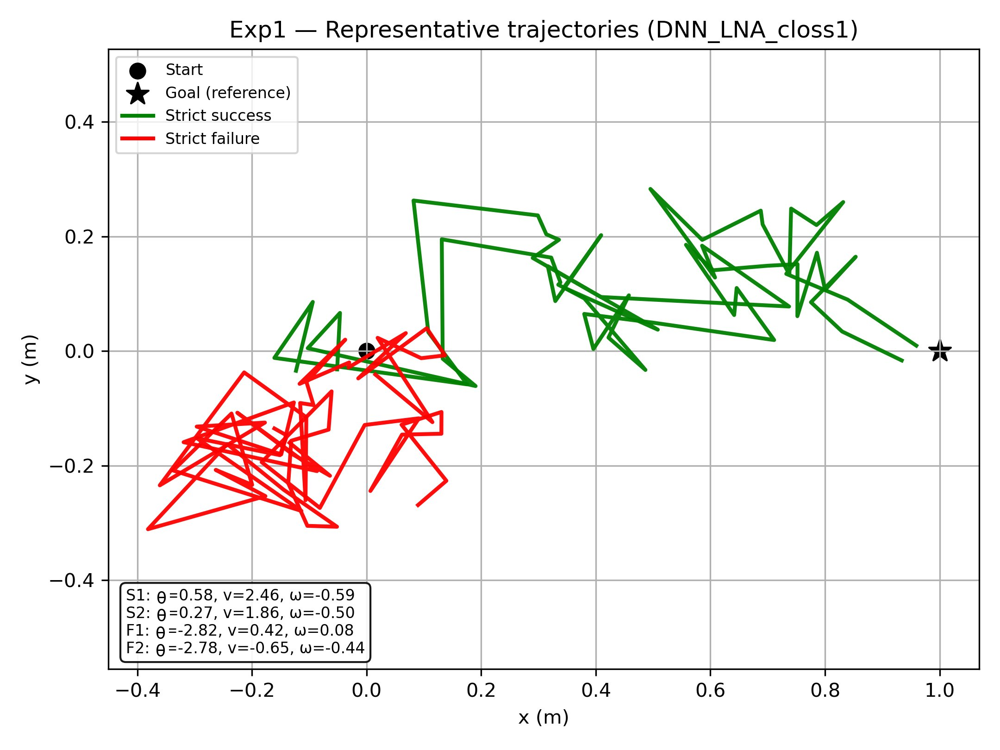
  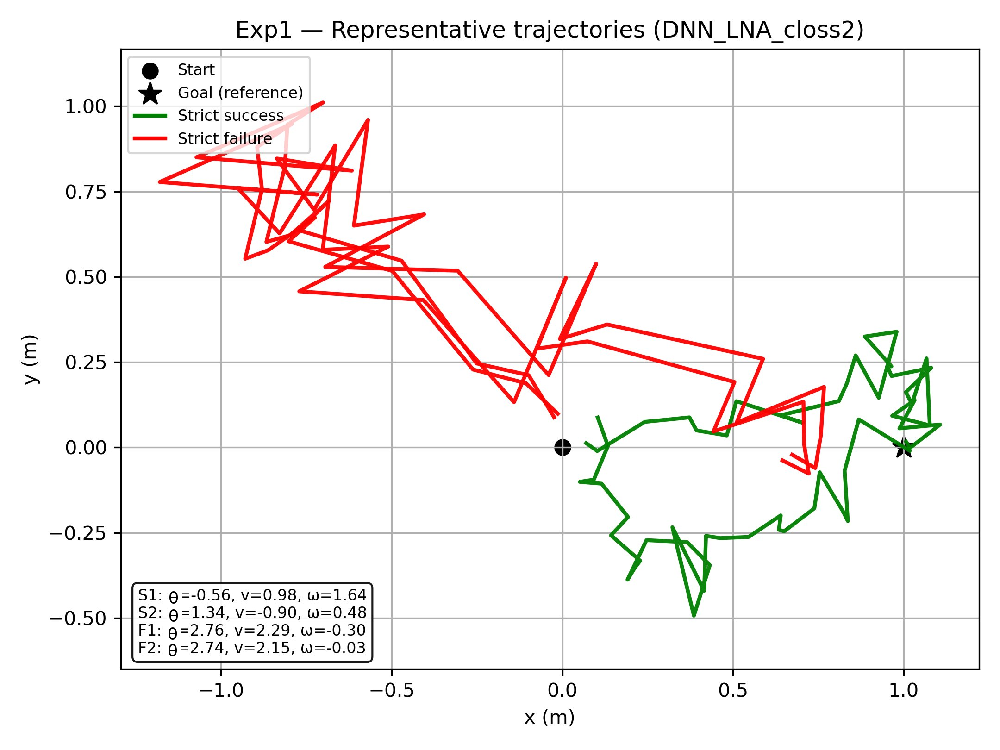
</p>
<p align="center"><sub>Representative trajectories for the worst- and best-performing models at the reference goal (1.0, 0.0) (thesis Figs. 4.1–4.2). Green: strict success (d &lt; 0.30 m); red: failure. For <code>DNN_LNA_closs1</code>, failures are predominantly associated with initial orientations near θ ≈ ±π, i.e. the wheelchair starting with its back to the goal.</sub></p>

<p align="center">
  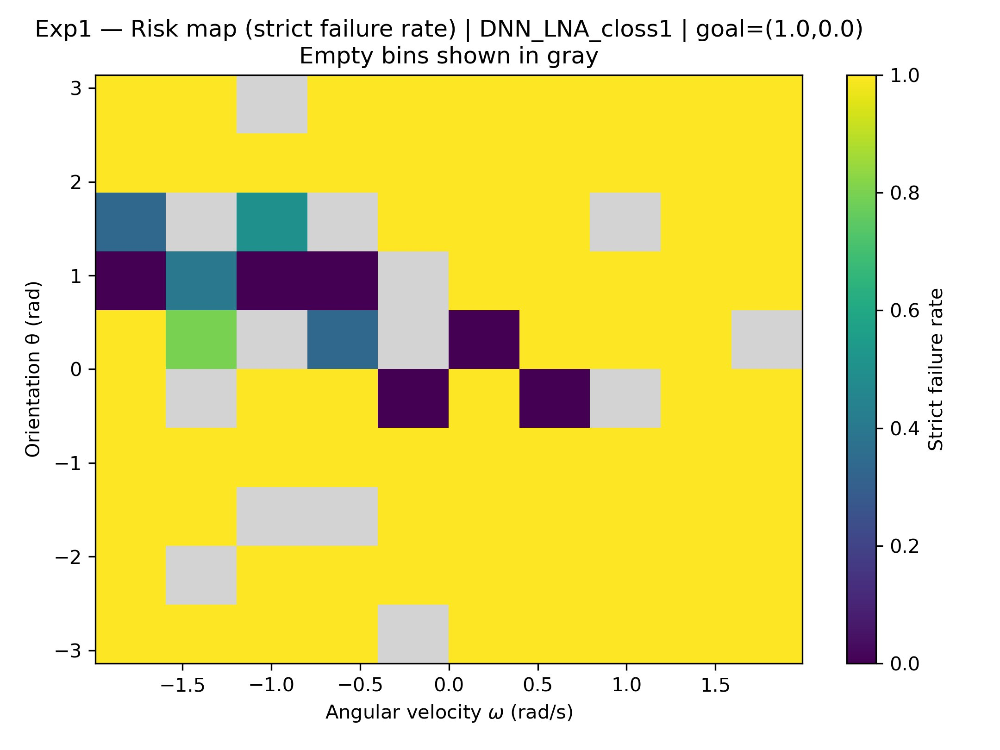
</p>
<p align="center"><sub>Risk map for <code>DNN_LNA_closs1</code> (thesis Fig. 4.3): high failure rates concentrate in the bands θ ≈ ±π and persist across the full range of ω, while |θ| &lt; 1.5 rad shows consistently lower failure rates. Grey bins are sparsely sampled.</sub></p>

<details>
<summary><b>Supplementary view: orientation × velocity × final distance</b></summary>

<p align="center">
  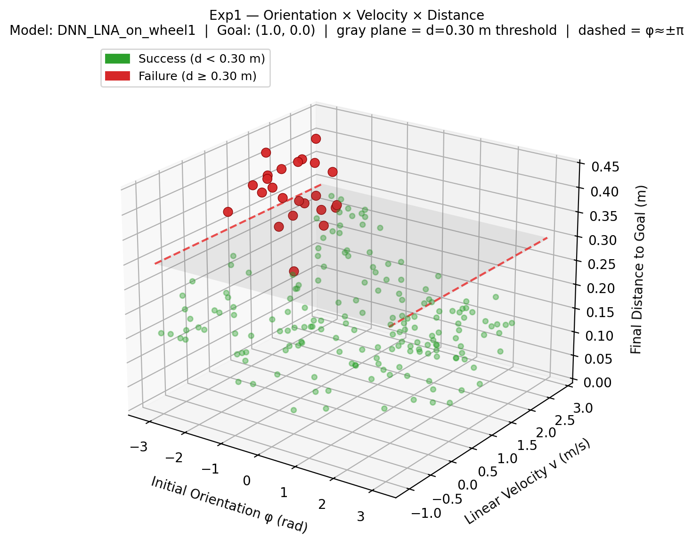
</p>
<p align="center"><sub><code>DNN_LNA_on_wheel1</code> at goal (1.0, 0.0), from the repository results; the grey plane is the 0.30 m threshold.</sub></p>

</details>

### Experiment 2: soft outcomes

<p align="center">
  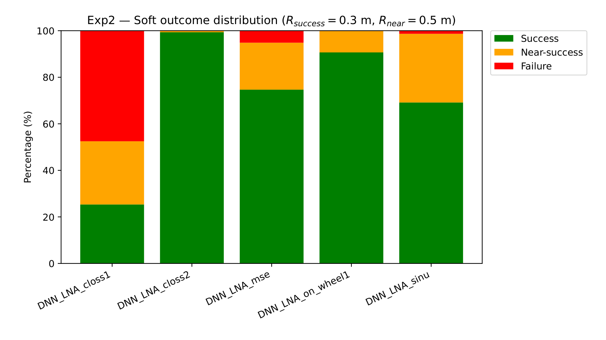
</p>
<p align="center"><sub>Soft outcome distribution aggregated over all goals (thesis Fig. 4.6; d_success = 0.30 m, d_near = 0.50 m). <code>DNN_LNA_closs2</code> is almost entirely Success; <code>DNN_LNA_closs1</code> is dominated by Failure with a small Near-success band; <code>DNN_LNA_mse</code> and <code>DNN_LNA_sinu</code> show a visible Near-success band.</sub></p>

### Decision-tree surrogates

| Model | Success / Failure (of 600) | Nodes (internal / leaves) | Train accuracy | Root split |
|---|:---:|:---:|:---:|---|
| `DNN_LNA_closs2` | 596 / 4 | 5 (2 / 3) | 0.99 | `θ ≤ 2.27 rad` |
| `DNN_LNA_on_wheel1` | 544 / 56 | 19 (9 / 10) | 0.94 | `θ ≤ −2.83 rad` |
| `DNN_LNA_mse` | 448 / 152 | 27 (13 / 14) | 0.88 | `ω ≤ 1.42 rad/s` |
| `DNN_LNA_sinu` | 415 / 185 | 25 (12 / 13) | 0.85 | `v ≤ −0.68 m/s` |
| `DNN_LNA_closs1` | 152 / 448 | 27 (13 / 14) | 0.90 | `GoalX ≤ 0.75 m` |

Extracted rules for the two extreme models (thesis §4.2.4):

- **`DNN_LNA_closs2`**: all three leaves predict Success. `θ ≤ 2.27 rad → Success` (480 samples, 100 %); `θ > 2.27 ∧ v ≤ 1.78 m/s → Success` (97 samples, 97 %); `θ > 2.27 ∧ v > 1.78 m/s → Success` (23 samples, 87 %). The only risk-adjacent region is a near-backward orientation combined with high forward speed.
- **`DNN_LNA_closs1`**: `GoalX ≤ 0.75 m → Failure`; `GoalX > 0.75 ∧ θ ≤ −2.36 rad → Failure`; `GoalX > 0.75 ∧ θ > −2.36 ∧ v ≤ 0.58 m/s → Failure`; `GoalX > 0.75 ∧ −2.36 < θ ≤ 1.80 rad ∧ v > 0.58 m/s → Success`. Success requires a forward-facing orientation *and* sufficient speed, and near-lateral goals fail almost regardless of the command.

<p align="center">
  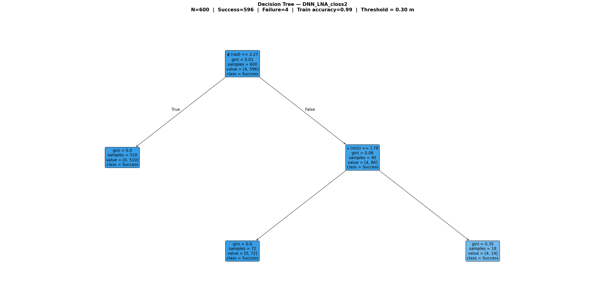
</p>
<p align="center"><sub>Decision tree for <code>DNN_LNA_closs2</code> (N = 600, train accuracy 0.99, threshold 0.30 m; thesis Fig. 4.4). Blue nodes: predicted Success; orange nodes: predicted Failure. In the tree plots the orientation feature is labelled ϕ; it is the same quantity denoted θ in the text.</sub></p>

<details>
<summary><b>Decision trees of the other four models</b></summary>

<p align="center">
  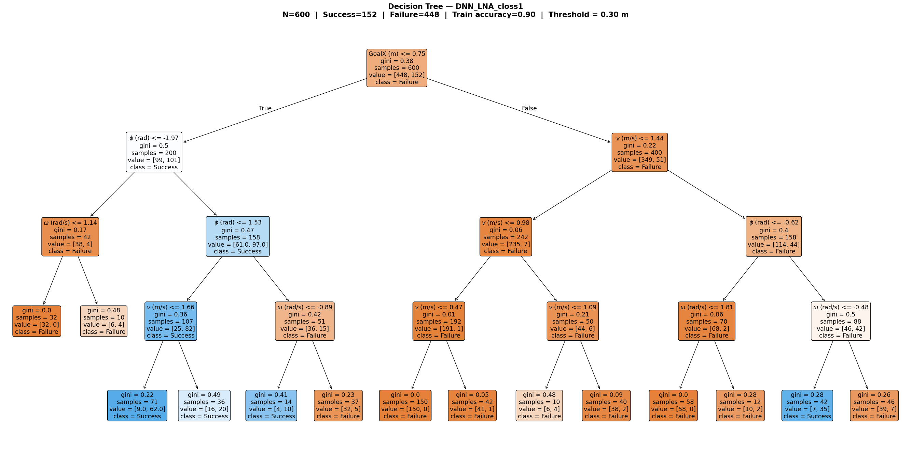
</p>
<p align="center"><sub><code>DNN_LNA_closs1</code> (train accuracy 0.90; thesis Fig. 4.5). Further trees: <a href="results/figures/tree_DNN_LNA_mse.png"><code>tree_DNN_LNA_mse.png</code></a> · <a href="results/figures/tree_DNN_LNA_on_wheel1.png"><code>tree_DNN_LNA_on_wheel1.png</code></a> · <a href="results/figures/tree_DNN_LNA_sinu.png"><code>tree_DNN_LNA_sinu.png</code></a>.</sub></p>

</details>

## Key findings

Within the evaluated model family (five pretrained DNN-LNA predictors) and the experimental conditions above:

| # | Finding | Evidence |
|---|---|---|
| 1 | **Failures are structured, not random.** They concentrate in identifiable regions of the command space. | risk-map bands at θ ≈ ±π; tree rules with training accuracy 0.85–0.99; risk maps, success tables and rules agree on the same zones |
| 2 | **Initial orientation θ is the main failure trigger.** θ appears in the first or second split of all five trees, three times at \|θ\| > 2.2 rad. | root splits on θ for `closs2` and `on_wheel1`; second-level splits on θ for `mse`, `sinu` and `closs1`; the `closs1` risk map |
| 3 | **Reliability differs by 74 percentage points** between models that share the same interface and were evaluated under identical conditions. | strict success 99.3 % (`closs2`) → 90.7 % → 74.7 % → 69.2 % → 25.3 % (`closs1`) |
| 4 | **Each model has a distinct, interpretable failure mechanism.** | root splits on `GoalX` (`closs1`), ω (`mse`), v ≤ −0.68 m/s, i.e. backward motion (`sinu`), θ (`closs2`, `on_wheel1`) |
| 5 | **The most reliable models have the simplest trees.** | 5 nodes at 99.3 % and 19 at 90.7 %, against 25–27 nodes for the three least reliable models (five models only, so this is an observation, not a law) |
| 6 | **Failure severity differs qualitatively.** | average final distance 0.130 m (`closs2`) vs 0.482 m (`closs1`); the failures of `closs2` are near-misses within 0.36 m |
| 7 | **`DNN_LNA_closs1` fails systematically for near-lateral goals.** | rule `GoalX ≤ 0.75 m → Failure`; per-goal success 50.5 / 10.5 / 15.0 % |
| 8 | **The extracted rules could serve as pre-execution checks** on the command vector. | e.g. flag θ > 2.27 rad with v > 1.78 m/s for `closs2`; the four-rule corridor for `closs1` |

**On the training objective.** All five models were evaluated under identical conditions, so the reliability gap cannot come from input coverage or evaluation method. The thesis concludes that within this comparison the choice of training loss is the dominant factor. Two qualifications apply. First, the models also differ in number of layers and input parametrisation (see [Models](#models)), so the comparison does not isolate the loss function. Second, the loss definitions are documented only in the project deliverable. The conclusion concerns the evaluated DNN-LNA family, not neural trajectory predictors in general.

## Practical implications

The agreement between risk maps, success tables and tree rules suggests that failure-prone inputs can be recognised **from the command vector alone, before execution**. The thesis proposes three uses:

- **Dynamic command filtering**: scale or redirect commands in high-risk regions (e.g. θ > 2.27 rad with v > 1.78 m/s for `closs2`, or outside the narrow success corridor of `closs1`).
- **Hybrid navigation fallback**: switch to a conservative model-based planner when the goal lies in a known high-failure region.
- **Predictive failure monitoring**: use the strict/soft distinction and the average distance to monitor navigation confidence, with drift into the Near-success zone triggering feedback.

> [!NOTE]
> **Demonstrated vs. proposed.** The experiments demonstrate, offline, that failure regions are structured and can be described by explicit rules on the command vector. The three uses above are **proposals**; no real-time filter, fallback controller or monitor was implemented or deployed on a wheelchair, and no formal safety guarantee is claimed.

## Verifying the published results

The thesis results are published as files. These tools check them without the models and without changing anything:

| Command | What it checks |
|---|---|
| `python tools/manifest.py --check` | every published table, figure, notebook and source file (40 artifacts) still has the SHA-256 recorded in [`docs/artifacts.sha256`](docs/artifacts.sha256) |
| `python tools/verify_results.py` | 42 arithmetic checks that recompute the thesis numbers from `results/tables/`: per-goal and overall strict success (Table 4.1), goal-B and overall average distance (Table 4.2), decision-tree class counts, and the consistency of the orientation-bin tables |
| `pytest` | the two checks above, plus a smoke test that runs the unchanged `src/` pipeline end to end with a synthetic stand-in model (no TensorFlow needed) |

GitHub Actions runs all three on every push. [`docs/ARTIFACTS.md`](docs/ARTIFACTS.md) lists every result file with its role and status.

## Reproducibility

**Publicly reproducible from this repository**

- The complete evaluation pipeline (`src/`): input sampling with a fixed seed, batched inference against the DNN-LNA SavedModel interface, final-distance computation, strict/soft labelling and figure generation.
- All derived results of the thesis: per-model and per-goal tables, the decision trees of the five models and the result figures (`results/`), with the checks above.
- A synthetic-data demonstration of the full methodology, runnable without any proprietary asset (`notebooks/demo_analysis.ipynb`).

**Not reproducible**

- **The DNN-LNA model weights.** They are proprietary assets of REXASI-PRO. Without them, `src/evaluate.py` cannot regenerate the raw trajectories; the numbers in `results/` can be checked but not recomputed from scratch.
- The decision-tree fitting on the real outputs. The trees in `results/figures/` were fitted with scikit-learn (`max_depth = 4`, `min_samples_leaf = 10`, Gini) on the 600 labelled observations per model; the notebook shows the identical procedure on synthetic data.

**Provenance of `results/`**

- `results/figures/table_success_rate.png` and `table_avg_distance.png` are thesis Tables 4.1 and 4.2; `results/figures/tree_*.png` are thesis Figs. 4.4, 4.5 and A.1–A.3.
- `results/tables/exp1_failure_distance_summary.csv`, `combined_overview.csv` (column `Exp1`), `exp1_input_sensitivity_goal_1_0.csv`, `summary_avg_success.csv` (`AvgDist` of the `Exp1` rows), `exp1_theta_sensitivity.csv` and `exp1_bad_theta_bins.csv` are consistent with the thesis (checked by `tools/verify_results.py`).
- `results/extracted_rules.txt` and `results/feature_importances.txt` come from an **earlier exploratory tree (depth 8, features θ, v, ω only)** and do not correspond to the depth-4 trees reported in the thesis.
- Figures under `results/figures_exp1/` and `results/figures_exp2/` are raw outputs of the evaluation runs; those not referenced in this README are provided as-is for inspection.

### Getting started

```bash
git clone https://github.com/pouyapd/SafeTraj-Experiments.git
cd SafeTraj-Experiments

# without the models: check the published results
pip install -r requirements-dev.txt
python tools/verify_results.py      # 42 consistency checks against the thesis tables
python tools/manifest.py --check    # published artifacts unchanged
pytest                              # both checks + smoke test of the src/ pipeline (7 tests)
```

**With access to the DNN-LNA models**, install `requirements.txt` (TensorFlow ≥ 2.12). `src/model_utils.py` expects one TensorFlow SavedModel per model at `<model_root>/<MODEL_NAME>/DNN_LNA_model/`, exposing a `serving_default` signature with inputs `input_1` (occupancy map), `input_2` (θ, v, ω) and `input_3` (goal vector) and returning a `(N, 5, 30)` or `(N, 30, 5)` trajectory tensor. Then:

```bash
python src/evaluate.py --model_root /path/to/models --output_dir results
```

This samples `N = 200` inputs (seed 42), runs both experiments for the five models and three goals, and writes `exp1_inputs.npy`, `exp1_samples.csv` and `exp2_goal_summary.csv` to `<output_dir>/tables/` and the figures to `<output_dir>/figures_exp1/` and `<output_dir>/figures_exp2/`. Model names, input ranges, goals and thresholds are set in `src/config.py`.

### Demo notebook

[`notebooks/demo_analysis.ipynb`](notebooks/demo_analysis.ipynb) walks through the methodology end to end **on synthetic data** and needs no proprietary model or dataset. It executes without errors locally (Python 3.12); running it in Google Colab has not been checked.

| Section | What it does | Data source |
|---|---|---|
| Synthetic data generation | samples (θ, v, ω) over the thesis operational ranges and goals from {0.5, 1.0, 1.5} × {0.5, 0.0, −0.5}; assigns synthetic final distances that mimic the qualitative patterns reported in the thesis (higher failure near θ ≈ ±π, added risk at high \|ω\|, harder distant goals) | **synthetic** |
| Exp1, input sensitivity | scatter plots of each input against final distance with the 0.30 m threshold; binned (θ, ω) risk map | synthetic |
| Exp2, model comparison | stacked Success / Near-success / Failure bars and a ranking table for the five models | strict success rates are the **thesis values** (25.3 / 99.3 / 74.7 / 90.7 / 69.2 %) entered as constants; the near-success/failure splits are illustrative |
| Explainability | fits a `DecisionTreeClassifier` (`max_depth = 4`) on `(GoalX, GoalY, θ, v, ω)` and plots it | synthetic; the reported accuracy is for demonstration only |
| Summary | prints the key findings | thesis findings, restated |

The notebook illustrates *how* the analysis is performed; the *actual* results are those in `results/` and in the thesis.

## Limitations

- **Black-box evaluation.** Internal representations, weights and activations were not analysed, so the root causes of failure inside the networks remain partly opaque.
- **Offline setting.** All analysis is offline on uniformly sampled inputs in an obstacle-free workspace. Moving obstacles, floor friction, sensor noise and real user command distributions were not modelled.
- **Limited coverage.** Five models, `N = 200` inputs per goal and `G = 3` goals: enough to identify systematic trends, and some model pairs are not separated at this sample size (see the interval figure).
- **Fixed success threshold.** The strict criterion `d < 0.30 m` was fixed throughout; results could differ under other thresholds.
- **Decision trees as surrogates.** With `max_depth = 4` the trees cannot capture all interaction effects (training accuracies 0.85–0.99). The rules are derived from the same data used for evaluation; the thesis relies on their agreement with the independently computed risk maps and success tables.
- **Proprietary models.** The raw experiments cannot be re-run without the DNN-LNA weights.

<details>
<summary><b>Future work identified in the thesis</b></summary>

- **Real-time collision-avoidance filtering**: integrate the risk maps and decision-tree rules into a live control loop.
- **Hybrid navigation fallback**: revert to a classical model-based planner in known failure regions or when the predictor signals low confidence.
- **Advanced explainability**: extend the tree analysis with feature-attribution methods such as SHAP or LIME.
- **On-platform validation**: physical testing on the smart wheelchair to confirm that the risk zones and rules hold under real sensor and actuator conditions.
- **Adaptive thresholds**: adapt the success threshold to the environment or user and study how risk maps and tree boundaries shift.

</details>

## Repository map

```text
SafeTraj-Experiments/
├── docs/
│   ├── ARTIFACTS.md                # index of every result file and its status
│   ├── artifacts.sha256            # SHA-256 manifest of the 40 published artifacts
│   ├── figures/                    # thesis figures used in this README; derived/: additional views
│   └── assets/                     # README banner and social preview (presentation only)
├── notebooks/
│   └── demo_analysis.ipynb         # synthetic-data demonstration of the methodology
├── src/
│   ├── config.py                   # seed, model names, input ranges, goals, thresholds, paths
│   ├── model_utils.py              # SavedModel loading, batched inference, final-distance computation
│   └── evaluate.py                 # Experiment 1 + Experiment 2 pipeline and figure generation
├── tools/                          # read-only checks: manifest.py, verify_results.py, derived_figures.py
├── tests/                          # artifact integrity, thesis-number consistency, pipeline smoke test
├── results/
│   ├── figures/                    # thesis tables (PNG) and decision trees for all five models
│   ├── figures_exp1/               # Experiment 1 figures
│   ├── figures_exp2/               # Experiment 2 figures
│   ├── tables/                     # CSV outputs of the evaluation runs
│   ├── extracted_rules.txt         # earlier exploratory depth-8 tree (see Provenance)
│   └── feature_importances.txt     # earlier exploratory depth-8 tree (see Provenance)
├── requirements.txt
├── requirements-dev.txt            # tools and tests (no TensorFlow)
├── LICENSE
└── README.md
```

## Related projects

- [trajectory-failure-analysis](https://github.com/pouyapd/trajectory-failure-analysis): the same failure-analysis approach on real pedestrian trajectories (ETH dataset), preprint.
- [SafeTraj-Prototype](https://github.com/pouyapd/SafeTraj-Prototype): the workflow as a reusable toolkit for any trajectory predictor.
- [SafeNav-RL](https://github.com/pouyapd/SafeNav-RL): reinforcement learning with a control-barrier-function safety filter (simulation).

## Citation

```bibtex
@mastersthesis{bathaeipourmand2026safetraj,
  author  = {Bathaei Pourmand, Pouya},
  title   = {Analysis of Neural Trajectory Prediction for Collision Avoidance in Smart Wheelchairs},
  school  = {DIBRIS, University of Genoa},
  year    = {2026},
  month   = jul,
  note    = {MSc thesis. Supervisors: L. Oneto, M. Mongelli; co-supervisor: S. Narteni. Carried out within the EU Horizon Europe project REXASI-PRO (Grant Agreement No. 101070028-2)}
}
```

The DNN-LNA models are described in: Z. Duan, S. Autexier, J. Janssen, C. Mandel, *TensorFlow model description for DNN-LNA*, REXASI-PRO Project Deliverable D3.2, DFKI, 2024.

## License

The code, figures and result files in this repository are released under the [MIT License](LICENSE).

The DNN-LNA models (weights, architectures and training data) remain proprietary assets of the REXASI-PRO project and its partners; they are **not** distributed with this repository and are **not** covered by this license.
